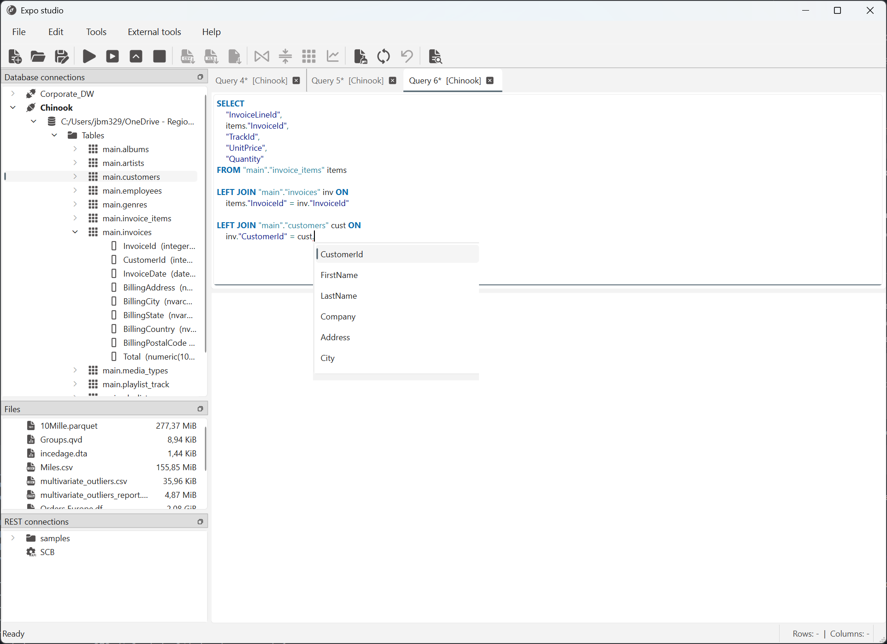

# Get data

Bring data into Expo Studio from a database, a local data file or a configured
REST request. Database queries, supported data files and REST responses appear
as datasets in result tabs; SQL text and HTML files open elsewhere.

| Source | Start here |
|---|---|
| Database | Connect to a database, write or generate SQL, then run it. |
| Local file | Open a supported data file from the Files panel or the Open command. |
| REST API | Load a saved request from the REST connections panel. |

## Load data with SQL {#databases-and-sql}

Configure a named connection first. See
[Database connections](../workbench/database-connections.md) for supported
connection types, drivers, authentication and testing.

1. In the workbench's **Database connections** panel, right-click the saved
   connection and select **Connect**.
2. Expand the database and its **Tables** or **Views**. Double-click a table or
   view to put a generated `SELECT` statement in an SQL editor tab.
3. Review the generated statement or write your own query. Confirm the
   connection shown in the editor tab title; if needed, right-click the tab and
   select **Associate with connection**.
4. Select **Run query** to execute the full editor contents, or select SQL text
   and choose **Run selection**. **Run top 10** requests a row-limited result
   from the full query; it does not mean “run the selected text.”
5. Wait for the query to finish, then select its result tab to review the
   returned rows.

Generating SQL from a table or view only prepares text; it does not run the
query. A saved SQL file also opens as editor text and needs an associated
connection before it can run. For editor controls and result-tab behavior, see
[Workbench window](../workbench/index.md#sql-editor).

While you edit a query, the SQL editor highlights its syntax and lints the
text. With a database connection associated with the tab, syntax highlighting
and linting use that connection's SQL dialect. Linting can point out issues
before you run the query, but it does not replace checking the result or any
database-specific errors reported during execution.

### Use SQL autocomplete

Autocomplete also uses the connection's SQL dialect and available schema
metadata. Suggestions appear as you type a period after a schema, table or
table alias: `schema.` offers tables in that schema, `table.` offers its
columns, and `alias.` offers columns from the table referenced by that alias in
the query. Continue typing after the period to narrow the suggestions. Press
**Ctrl+Space** to request suggestions while editing. Suggestions depend on the
connection, query context and metadata available to the editor; they are not a
SQL syntax checker or a list of every object you can query.

*The suggestions in this example come from the connected database's schema.
Names and available suggestions depend on your connection.*

If expected objects or columns are missing, check the editor's connection and
refresh its schema with **Update schema**. The query still needs to be valid for
the connected database and your permissions.

## Open a local file {#files}

Use **Open** on the toolbar or **File → Open**, or double-click a supported data
file in the workbench's **Files** panel. Opening a data file creates a result
tab. The Files panel shows the configured documents directory; change it in
[Settings](../workbench/settings.md#basic-settings).

| File type | Supported suffixes |
|---|---|
| CSV | `.csv` |
| Excel | `.xls`, `.xlsx` |
| Parquet | `.parquet` |
| Feather | `.feather`, `.ft` |
| Pickle/dataframe | `.df`, `.pkl` |
| Qlik QVD | `.qvd` |
| SPSS | `.sav` |
| Stata | `.dta` |

Importing is not the same as exporting: the supported output formats are
different. For CSV reading options such as delimiter detection and encoding,
see [CSV settings](../workbench/settings.md#csv-settings).

The **Open** command also accepts other file types with different behavior:

- A `.sql` file opens its text in an editor tab. It does not execute the query;
  associate the tab with a database connection before running it.
- An `.html` or `.htm` file opens in your default browser, not as a dataset.
- A local `.json` file is not supported by this Open workflow. JSON returned by
  a configured REST request is a separate workflow.

## Load a REST response {#rest-apis}

Configure and save a request in **Tools → REST connections…** first. The
[REST API connections guide](../workbench/rest-api-connections.md) explains
request fields, authentication, response paths, pagination and the
[SCB query builder](../workbench/rest-api-connections.md#scb-query-builder).

1. In the workbench's **REST connections** panel, find the saved request.
2. Double-click it, or right-click it and select **Load data**.
3. Wait for the background request and conversion to finish, then select the
   result tab.

The configured client supports **GET** and **POST** requests returning JSON.
The response must have a structure the application can convert into a table;
for nested data, configure a response path in the request. Page-number
pagination is available when it matches the API. This is not a general-purpose
client for every HTTP method, response format or API pagination scheme.

**Test** in the REST connections dialog checks one request using the current
form. It does not save the form or create a result tab. Loading a saved request
from the workbench is the step that fetches data into a dataset.

## Work with the loaded dataset {#next-steps}

Select the ready result tab you want to use. You can inspect and prepare its
columns, open **Analyze data**, or export the dataset. See
[Review and understand your data](../application-overview.md#review-data),
[Clean and transform data](../application-overview.md#clean-and-transform)
and [Export data](../export-and-report/index.md) for the available export
workflows.

For the workbench layout, source panels and editor/result areas, see
[Workbench window](../workbench/index.md).
