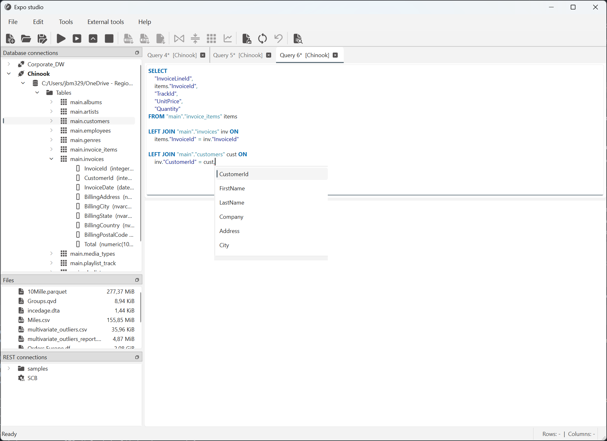

# Load data with SQL

Use a database query to load rows into a result tab. Configure a named
connection first; see [Database connections](../workbench/database-connections.md)
for supported connection types, drivers, authentication and testing.

1. In the workbench's **Database connections** panel, right-click the saved
   connection and select **Connect**.
2. Expand the database and its **Tables** or **Views**. Double-click a table or
   view to put a generated `SELECT` statement in an SQL editor tab.
3. Review the generated statement or write your own query. Confirm the
   connection shown in the editor tab title; if needed, right-click the tab and
   select **Associate with connection**.
4. Select **Run query** to execute the full editor contents, or select SQL text
   and choose **Run selection**. **Run top 10** requests a row-limited result
   from the full query; it does not mean “run the selected text.”
5. Wait for the query to finish, then select its result tab to review the
   returned rows.

Generating SQL from a table or view only prepares text; it does not run the
query. A saved SQL file also opens as editor text and needs an associated
connection before it can run. For editor controls and result-tab behavior, see
[Workbench window](../workbench/index.md#sql-editor).

While you edit a query, the SQL editor highlights its syntax and lints the
text. With a database connection associated with the tab, syntax highlighting
and linting use that connection's SQL dialect. Linting can point out issues
before you run the query, but it does not replace checking the result or any
database-specific errors reported during execution.

## Use SQL autocomplete

Autocomplete also uses the connection's SQL dialect and available schema
metadata. Suggestions appear as you type a period after a schema, table or
table alias: `schema.` offers tables in that schema, `table.` offers its
columns, and `alias.` offers columns from the table referenced by that alias in
the query. Continue typing after the period to narrow the suggestions. Press
**Ctrl+Space** to request suggestions while editing. Suggestions depend on the
connection, query context and metadata available to the editor; they are not a
SQL syntax checker or a list of every object you can query.

*The suggestions in this example come from the connected database's schema.
Names and available suggestions depend on your connection.*

If expected objects or columns are missing, check the editor's connection and
refresh its schema with **Update schema**. The query still needs to be valid for
the connected database and your permissions.

## Continue your workflow

- [Get data overview](index.md) for other ways to load data.
- [Prepare data](../prepare-data/index.md) or
  [Transform data](../transform-data/index.md) to work with query results.
- [Analyze data](../analyze-data/index.md) or
  [Export data](../export-and-report/index.md) when your dataset is ready.
