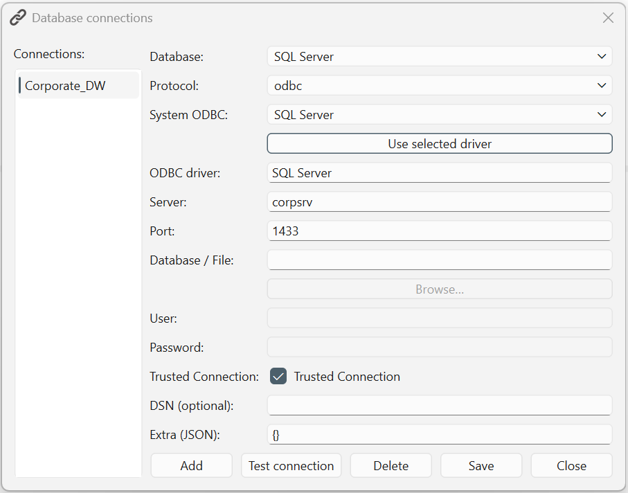

# Database connections

Select **Tools → Database connections…** in the [workbench window](../workbench/index.md)
to manage named database connections. Save the connection details here, then
connect through the workbench's **Database connections** panel to browse the
schema and prepare queries.

For other configuration topics, see the [Settings overview](index.md).

*The dialog with a SQL Server connection selected. Names, server details and
authentication settings depend on your environment. Not every field applies
to every database or protocol.*

## Add a connection {#add-connection}

1. Select **Add**, enter a unique **Name**, then confirm.
2. Select the new entry under **Connections**.
3. Choose the **Database** type. This sets a suggested **Protocol** and, where
   applicable, a default **Port**.
4. Fill in the applicable connection fields. For ODBC, choose an installed
   driver under **System ODBC** and select **Use selected driver**.
5. Select **Save** to persist your edits, or **Test connection** to save the
   current form and try a connection.
6. Select **Close** when finished.

**Add immediately saves a new entry with initial values.** It does not wait
for you to finish configuring the connection. **Test connection also saves the
current form before testing**, even if the connection attempt fails. Invalid
DuckDB settings are rejected before either saving or testing.

**Close** does not save edits still in the form, but it does not undo an Add,
Save, Test connection or confirmed Delete that has already been performed.

## Choose a database and protocol {#database-and-protocol}

The database type identifies the database engine; the protocol chooses the
connection driver.

| Database | Usual protocol | Connection details |
|---|---|---|
| **SQL Server** | `odbc` | An installed ODBC driver, server, optional port/database and authentication. The suggested port is **1433**. |
| **PostgreSQL** | `psycopg` | Server, database, user and password. The suggested port is **5432**. |
| **MySQL / MariaDB** | `pymysql` or `mysqlconnector` | Server, database, user and password. The suggested port is **3306**. |
| **SQLite (file-based)** | `sqlite` | A database-file path under **Database / File**. Use **Browse…** to select a file. |
| **DuckDB (file-based)** | `duckdb` | An existing local database file, opened read-only. Use **Browse…** to select it. |

The dropdown also contains **Oracle** and **Other**. These are not a guarantee
of a ready-to-use connector for any database. They depend on compatible installed
drivers and database-specific support; this guide does not provide a verified
setup recipe for them.

Changing the database type can replace the suggested protocol and port.
Review both before saving, particularly when your server uses a nonstandard port.
Disabled fields are expected when they do not apply to the selected protocol.

## Understand the connection fields {#connection-fields}

| Field | Purpose |
|---|---|
| **Connections** | Select the saved entry you want to inspect or edit. |
| **System ODBC** | Lists ODBC drivers found on this computer. Selecting one does not install it or copy it into the connection until you use **Use selected driver**. |
| **ODBC driver** | Shows the chosen driver. This field is read-only; use the driver selector and button to change it. |
| **Server** | The database server's hostname or address. |
| **Port** | The server's numeric port, when applicable. Use the value supplied for your database environment. |
| **Database / File** | A database name for a server connection, or a file path for SQLite/DuckDB. |
| **User**, **Password** | Database credentials when using username/password authentication. |
| **Trusted Connection** | Requests trusted authentication for an applicable ODBC connection, such as a configured SQL Server environment. Checking it clears and disables the User and Password fields. |
| **DSN (optional)** | Stores a data-source name. The current ODBC connection-string builder does not use this field as a substitute for driver/server details; do not rely on it for a DSN-only connection. |
| **Extra (JSON)** | Driver-specific options expressed as a JSON object. Leave `{}` unless you know which options the chosen driver accepts. |

**Use selected driver** can also infer a database type from the driver's name,
which can change the protocol or suggested port. Recheck the form after using it.

Passwords are masked in the dialog but saved in the local connection
configuration; masking is not encryption. Do not share connection configuration
files or screenshots containing credentials or private server details.

### Advanced options

Extra options are not universal. A PostgreSQL configuration can, for example,
use `{"sslmode": "require"}`; other protocols accept different options.
Do not assume arbitrary JSON keys or options for another driver will work.

Use valid JSON with double-quoted property names. For non-DuckDB connections,
the form can silently omit malformed JSON or a nonnumeric port rather than
rejecting the save. Reopen the saved entry to check the values and use
**Test connection** before relying on it.

## Connect to a local DuckDB file {#duckdb}

1. Add a named connection, then choose **DuckDB (file-based)**.
2. Select **Browse…** and choose an existing DuckDB database file.
3. Select **Test connection**.

The protocol is fixed to `duckdb`; server, port, authentication and extra-option
controls are disabled. DuckDB connections require an existing regular local
file and empty extra options. They do not create a new database or accept an
in-memory database, remote URL or MotherDuck connection.

Read-only access is enforced by the application, not selected through a checkbox.
It allows querying an existing database without writing changes to that file.
A file can pass path validation and still fail to open, for example if it is
not a valid DuckDB database.

## Test and use a saved connection {#test-and-use}

**Test connection** runs a small test query and reports success or an error.
It tests the edited form after saving it, rather than a disposable copy.
Success does not guarantee permission to read every table or view.

To browse and query:

1. Close the dialog.
2. In the workbench's **Database connections** panel, right-click the connection
   and select **Connect**.
3. Expand its tables and views.
4. Double-click a table or view to prepare a SELECT statement in an editor tab.
5. Check the editor tab's connection, then select **Run query** to load results.

Generating SQL and executing it are separate actions. See
[SQL editor tabs](../workbench/index.md#sql-editor) and
[result tabs](../workbench/index.md#result-tabs) for the corresponding workbench
areas.
For a complete walkthrough, see
[Load data with SQL](../get-data/sql-queries.md).

If a test fails, check the selected engine/protocol, driver installation, server,
port, database, access permissions and authentication. Use the error message
and any displayed hint; a saved entry alone does not establish a connection.

## Edit or delete a connection {#edit-or-delete}

Select an entry under **Connections**, change its fields and select **Save**.
Save each entry before switching to another; selecting an entry loads its saved
values into the form.

To remove an entry, select **Delete** and confirm. This removes the saved
connection definition, not the database or its files.

Changes involving DuckDB invalidate the application's cached connection and
schema state. You may need to reconnect before continuing to query.
