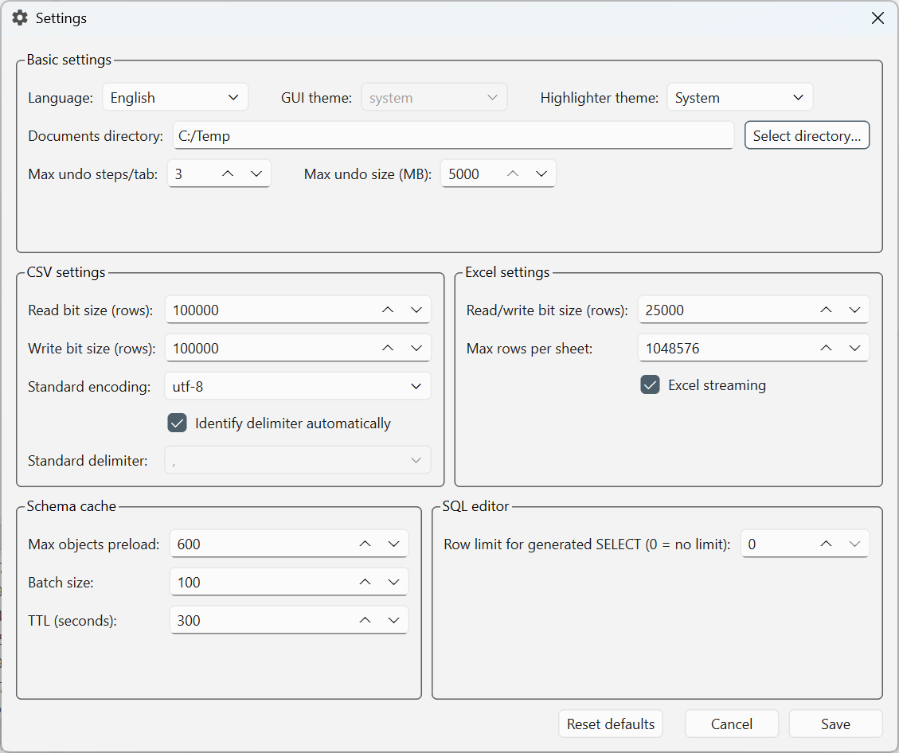

# General settings

Select **Tools → Settings…** in the [workbench window](../workbench/index.md)
to open the Settings dialog. For other configuration topics, see the
[Settings overview](index.md).

Select **Help** at the bottom left of the dialog or press **F1** to open this
General settings page in your default browser. Help does not save your edits
or close the dialog. If the browser cannot be opened, a warning includes the
manual URL.

*The Settings dialog. The directory and values shown are examples from this
configuration, not a list of application defaults.*

## Save or reset settings {#save-settings}

Change the fields you need, then select **Save**. The application saves the
settings and reloads them for the current session. File-processing changes
configure subsequent operations; they do not reload datasets already open.
Select **Cancel** to close without saving your edits.

**Reset defaults** fills the dialog with default values. Select **Save** to
persist that reset, or **Cancel** to leave the saved configuration unchanged.

## Basic settings {#basic-settings}

| Setting | What it controls |
|---|---|
| **Language** | The application interface language. Saving reloads the language configuration. |
| **GUI theme** | This control is disabled; it is not currently an editable appearance setting. |
| **Highlighter theme** | The SQL editor's syntax-highlighting colors. This is separate from the GUI theme. |
| **Documents directory** | The root directory shown in the **Files** panel. Enter a path or use **Select directory…**. Changing it does not move your existing files. |
| **Max undo steps/tab** | The maximum number of retained dataset snapshots per result tab. Set it to **0** to retain no undo steps. |
| **Max undo size (MB)** | A size threshold for an individual dataset snapshot, not a total memory budget. A snapshot must be smaller than this threshold to be retained. |

Undo history stores dataset snapshots, so larger limits can require more memory.
The size threshold uses the dataset's estimated in-memory size, not the size of
its source file on disk.

## CSV settings {#csv-settings}

The labels **Read bit size (rows)** and **Write bit size (rows)** refer to
**chunks of rows**, not bits or a limit on the total dataset size.

| Setting | What it controls |
|---|---|
| **Read bit size (rows)** | The number of rows processed per CSV reading chunk. The chunks are combined into the loaded dataset. |
| **Write bit size (rows)** | The number of rows processed per CSV writing chunk for chunked exports. |
| **Standard encoding** | A configured encoding candidate for CSV reading. The reader also checks byte-order marks and tries other encodings; this does not force the selected encoding. |
| **Identify delimiter automatically** | Tries to detect the input file's column separator. |
| **Standard delimiter** | The separator used when automatic detection is off, or as a fallback if detection fails. This control is editable only when automatic detection is unchecked. |

For example, to read a semicolon-separated file with an explicit separator,
uncheck **Identify delimiter automatically**, select **;** in
**Standard delimiter**, select **Save**, then open the file.

These delimiter settings concern reading. The standard CSV export writes
comma-separated UTF-8 data; changing the input delimiter or encoding does not
change that export format. For the dataset export steps and other output
formats, see [Export a dataset](../export-and-report/export-data.md).

## Excel settings {#excel-settings}

| Setting | What it controls |
|---|---|
| **Read/write bit size (rows)** | The row-batch size used by the streaming reader and writer, not a total-row limit. |
| **Max rows per sheet** | The row limit used when splitting streaming exports across worksheets. Each sheet includes a header row. |
| **Excel streaming** | Uses a write-only workbook for Excel exports to reduce workbook memory use. This checkbox controls writing, not whether Excel input uses the streaming reader. |

Keep **Max rows per sheet** between **2** and Excel's physical limit of
**1,048,576**, including the header. At the physical limit, a sheet can hold
**1,048,575 data rows** plus its header. The dialog allows values above Excel's
limit, but that does not make larger worksheets supported.

Streaming does not mean that result datasets remain on disk: loaded datasets
still occupy memory.

For the dataset export workflow, see
[Export a dataset](../export-and-report/export-data.md).

## Schema cache {#schema-cache}

These settings concern database metadata, such as tables, views and their
columns, rather than cached query-result rows.

| Setting | What it controls |
|---|---|
| **Max objects preload** | Limits the number of tables/views whose missing column metadata is prefetched. **0** means no object limit, not disabled preloading. |
| **Batch size** | The number of objects processed in each metadata-prefetch batch. |
| **TTL (seconds)** | How long a cached schema entry is considered fresh when it is checked for reuse. It is not a periodic refresh interval. |

Use **Update schema** on the toolbar when you need to request a schema refresh
for the active editor's connection.

## SQL editor {#sql-editor}

**Row limit for generated SELECT (0 = no limit)** controls the row limit in
SELECT statements generated from the database schema browser. The generated
syntax depends on the database.

Set **0** to generate an unlimited SELECT. This setting does not rewrite SQL
you have already entered or impose a global limit on every query. The toolbar's
**Run top 10** remains a separate action.
