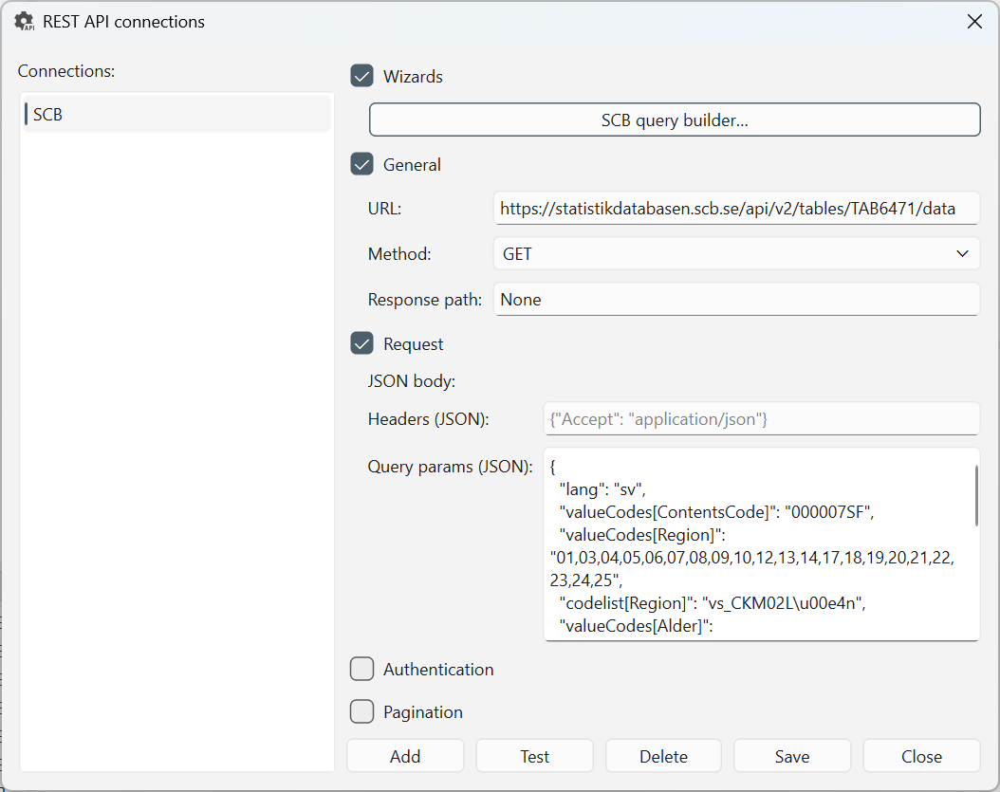
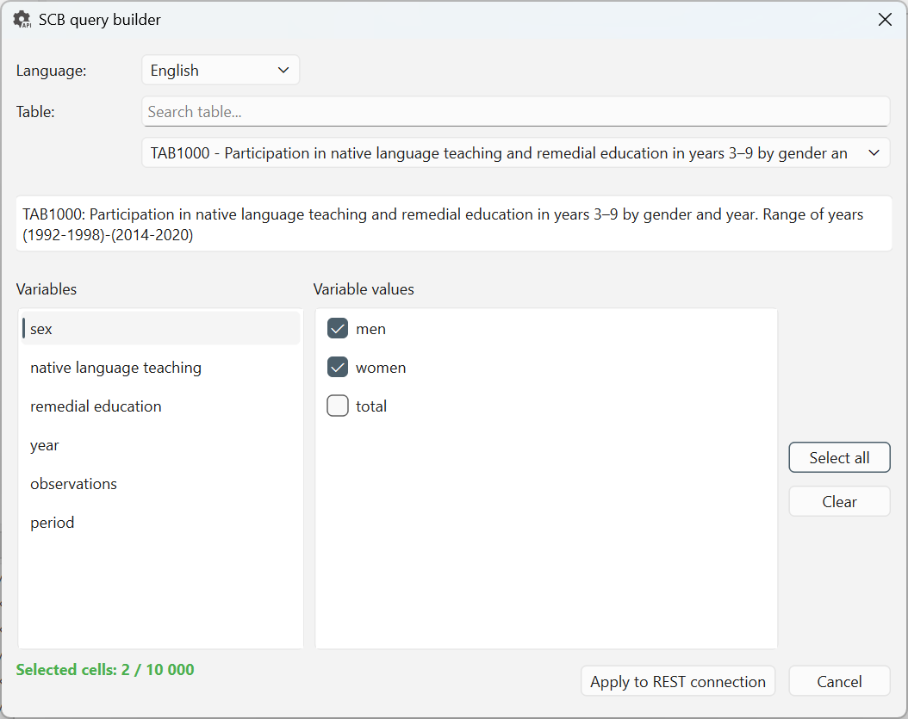

# REST API connections

Select **Tools → REST connections…** in the [workbench window](../workbench/index.md)
to manage named requests to REST APIs. Configure the endpoint and request
options here, then load the response as a result dataset from the workbench's
**REST connections** panel.

Select **Help** below the **Connections** list or press **F1** to open this
REST API connections page in your default browser. Help does not save or send
the request and leaves your edits and the dialog open. If the browser cannot
be opened, a warning includes the manual URL.

For other configuration topics, see the [Settings overview](index.md).

The editor supports **GET** and **POST** requests returning JSON. It is not a
general-purpose client for every HTTP method or response format. Use the API
provider's documentation for its endpoint, parameters, authentication and limits.



*A configured Statistics Sweden request. The URL and parameters depend on the
chosen table and selections; they are not defaults for other APIs.*

## Add and save a request {#add-request}

1. Select **Add**, enter a unique **Name**, then confirm.
2. Select the entry under **Connections**.
3. Enter the endpoint **URL** and choose **Method**: **GET** or **POST**.
4. Fill in the applicable request, authentication and pagination settings.
   For SCB tables, you can instead start with the
   [SCB query builder](#scb-query-builder).
5. Select **Test** to request data and check how the response becomes a table.
6. Select **Save** to persist the selected request, then **Close**.

**Test uses the current form without saving it.** Unlike the
[Database connections](database-connections.md) dialog, a successful test here
does not persist your edits or create a result tab.

**Add** creates an entry in the dialog; use **Save** to persist its configuration.
Save each request before selecting another entry, which loads that entry's saved
form values. **Close** does not save pending edits or undo changes already saved.

The checkboxes beside **Wizards**, **General**, **Request**, **Authentication**
and **Pagination** expand or collapse their fields. **Collapsing a section does
not disable its settings.** To remove authentication or pagination, expand the
section and select **None** in its **Type** field.

## Configure the request {#request-fields}

| Field | Purpose |
|---|---|
| **URL** | The API endpoint to request, rather than its documentation or website address. |
| **Method** | **GET** sends query parameters; **POST** also sends a JSON body. |
| **Response path** | Selects the record container inside a nested JSON response. Leave blank to use the root. |
| **JSON body** | A JSON object for a POST request. This field is hidden for GET; switching to GET clears the body. |
| **Headers (JSON)** | A JSON object of HTTP header names and values, such as `{"Accept": "application/json"}`. |
| **Query params (JSON)** | A JSON object of parameter names and values, such as `{"limit": "100"}`. Parameters are sent with the URL for both GET and POST. |

Use double quotes in JSON and an object (`{...}`), not an array (`[...]`).
Headers and query-parameter values are converted to strings; use simple string
values rather than nested objects or arrays. A POST request requires a valid
JSON body.

Save and Test require a nonempty URL and valid request settings. If they are
unavailable, check the response-path syntax, JSON fields, required authentication
details and pagination fields. A valid form does not guarantee that the server
accepts the request.

### Select records with a response path {#response-path}

For an illustrative response:

```json
{
  "data": {
    "items": [
      {"region": "North", "amount": 100},
      {"region": "South", "amount": 80}
    ]
  }
}
```

Set **Response path** to `data.items`. The result is:

| region | amount |
|---|---|
| North | 100 |
| South | 80 |

Paths use dot-separated keys and zero-based numeric list indices, for example
`results.0.values`. They are not JSONPath expressions: do not use `$`, brackets
or wildcards. The selected object must be a list or object that can become a
table. An invalid path is reported during testing or loading.

The literal `None` shown in the screenshot is also treated as no response path;
leaving the field blank is clearer. Supported JSON-stat v2 datasets, including
SCB responses, are recognized directly and flattened into dimension columns and
a **Value** column without needing a response path.

## Configure authentication {#authentication}

Expand **Authentication**, then choose **Type**.

| Type | Details to supply |
|---|---|
| **None** | No authentication added by the authentication controls; suitable for public endpoints that do not require credentials. |
| **Bearer** | The token value. The client adds it to the Authorization header as a bearer token. |
| **Basic** | Username and password. |
| **API key** | The key's name, value and location: **Header** or **Query parameter**. |
| **OAuth2** | Token URL, client ID, client secret, grant type and optional scope. **Refresh token** also requires a refresh-token value. |

OAuth2 supports the **Client credentials** and **Refresh token** grants. There
is no interactive browser sign-in or authorization-code workflow in this dialog.
Choose the authentication scheme supported by the provider rather than copying
another API's settings.

Saved requests include their credentials in the local REST configuration.
Masked fields are not encrypted storage. Use HTTPS for requests containing
credentials and review URLs, headers, parameters, screenshots and configuration
files before sharing them.

## Configure pagination {#pagination}

Expand **Pagination** and choose **Page number** when the API accepts a numeric
page query parameter.

| Field | Purpose |
|---|---|
| **Page parameter** | The provider's query-parameter name, such as `page`. Required for page-number pagination. |
| **Start page** | First page number; defaults to **1** when blank and must be at least **1**. |
| **Page size parameter** | The parameter name used to request a page size, such as `limit`. Required if you enter a Page size. |
| **Page size** | Optional positive number of records requested per page. The API can impose its own limit. |
| **Max pages** | Optional positive limit on the number of pages fetched. Set a small limit while checking a new request. |

Loading the saved request increments the page parameter and combines the
normalized responses into one result dataset. It stops at Max pages or when
the client's empty-response check ends the sequence. That check uses the
top-level list or, for an object, its first list-valued field; it does not follow
Response path or inspect the provider's pagination metadata.

This mode does not implement cursor tokens, next-page links or offset-based
pagination. An API that repeats nonempty data can keep fetching, so use
**Max pages** to bound requests.

**Test sends one request using the form's query parameters.** It does not run
the page-number loop or automatically insert Start page/Page size. Include
the desired page parameters under **Query params (JSON)** to test a particular
page; verify the saved request's pagination separately when loading data.

## Generate SCB request syntax {#scb-query-builder}

The **SCB query builder…** under **Wizards** helps construct requests for
Statistics Sweden's statistical database. Instead of writing the endpoint and
SCB parameter syntax by hand, browse tables and select variable values.
Internet access is required to retrieve the table list and metadata.



*The builder displays labels from SCB metadata while generating parameters using
the corresponding variable and value codes. The screenshot illustrates the
controls, not a complete recommended selection.*

1. Add or select the REST connection you want to configure.
2. Expand **Wizards** and select **SCB query builder…**.
3. Choose **Swedish** or **English** under **Language**. This changes the SCB
   metadata/request language, not the application's language.
4. Search by table ID or title, then choose a **Table**.
5. Select a row under **Variables**, then check the desired **Variable values**.
   Repeat for the other variables needed by the table. **Select all** and
   **Clear** affect the current variable's values.
6. Review **Selected cells**. The builder multiplies selected value counts across
   selected variables and allows at most **10,000** cells. Reduce the selection
   or split it into smaller requests if it exceeds this limit.
7. Select **Apply to REST connection**.
8. Back in the REST editor, review the generated request, select **Test**, then
   **Save** when satisfied.

Applying replaces **URL**, sets **Method** to **GET** and fills
**Query params (JSON)** with syntax such as `lang` and `valueCodes[Region]`.
It does not save, test or load the request. Existing headers, response path,
authentication and pagination are not reset, so review them when reusing an
entry. Switching tables or languages in the builder clears its value selections.
**Cancel** leaves the REST form unchanged.

For example, selections for two regions and two periods generate parameter
syntax like this; actual variable names and codes come from the chosen table:

```json
{
  "lang": "en",
  "valueCodes[Region]": "01,03",
  "valueCodes[Tid]": "2026M01,2026M02"
}
```

This example represents **4 selected cells**. It illustrates the generated
syntax, not a complete query guaranteed to work for every SCB table. Unselected
variables are omitted; the cell counter is not a guarantee of the final response
size or a substitute for checking the table's required selections.

More query builders tailored to specific public REST APIs may be added in the
future. **SCB is the currently available builder**; other APIs can be configured
manually through the generic REST fields.

## Load, edit or delete a saved request {#load-request}

Close the dialog, then double-click the saved request in the workbench's
**REST connections** panel, or right-click it and select **Load data**.
Loading runs as a background job and creates a result tab; it does not require
SQL. For the source-to-result workflow, see
[Load a REST response](../get-data/rest-api.md). You can then review,
transform, analyze or export the result like other datasets. See
[Export data](../export-and-report/index.md) for the available workflows.

To edit, reopen **Tools → REST connections…**, select the entry and save its
changes. To remove an entry, select **Delete** and confirm. Deletion writes the
updated connection list immediately; it does not delete data at the API provider.

If a request fails, check the URL, method, JSON, authentication, provider limits
and response path. **Test** reports the returned table's shape, column names,
elapsed time and a sample row when available, but does not prove that every page
or future request will succeed.
