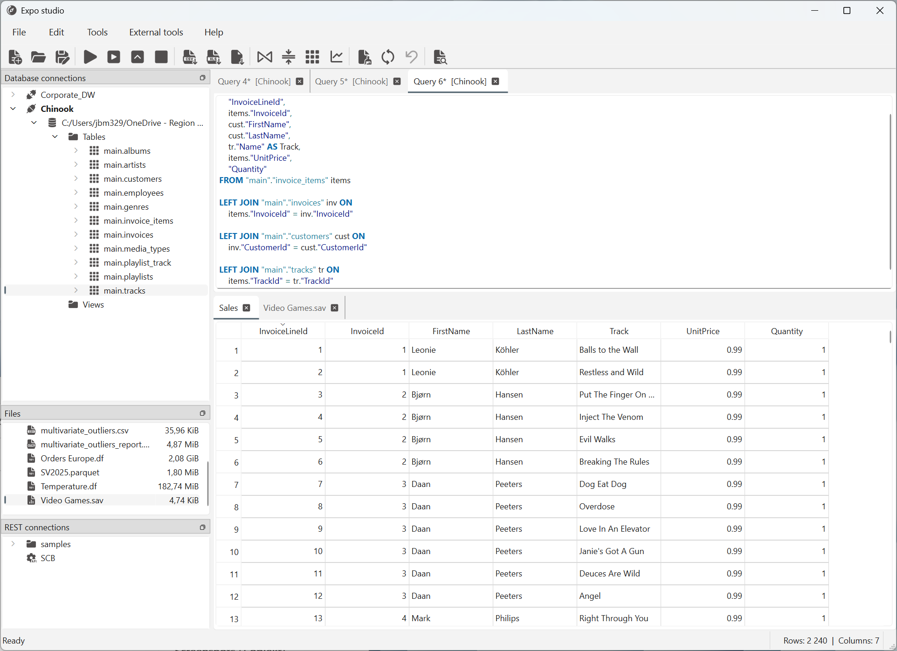

# Workbench window

The workbench is Expo Studio's main window. Use the source panels on the left
to find data, the upper editor area to work with SQL, and the lower result area
to review and prepare datasets.

For an introduction to the tasks you can perform, see
[What you can do with Expo Studio](../application-overview.md).

## Find your way around {#window-layout}

*The workbench before any editor or result tabs are open. The upper blank area
is for SQL editor tabs; the lower blank area is for result datasets. Connection
names and files depend on your configuration.*

| Area | Where to find it | Purpose |
|---|---|---|
| Menu bar | Across the top | File operations, settings, connection configuration and external tools. |
| Toolbar | Below the menu bar | Quick access to queries, dataset exports, preparation and analysis. |
| Source panels | Left side | Browse database connections, files and REST connections. |
| SQL editor area | Upper right | Write, open and save queries in separate editor tabs. |
| Result area | Lower right | Work with datasets loaded from files, database queries or REST requests. |
| Status bar | Along the bottom | Read status messages and dataset row/column counts. |

## Use the menu bar {#menu-bar}

| Menu | Available commands |
|---|---|
| **File** | **New file**, **Open**, **Save**, **Save as…**, the **Export…** submenu and **Quit**. New and Save actions concern SQL text; Export saves dataset contents. |
| **Edit** | **Clear editor** clears the active SQL editor. |
| **Tools** | **Settings…**, **Log settings…**, **Database connections…** and **REST connections…**. |
| **External tools** | **Data profiling…** generates an HTML data profile, with a comparison option when multiple ready datasets are open. This optional tool requires the profiling dependency. |
| **Help** | **About Expo studio…** opens application information. |

The **File → Export…** submenu offers CSV, Excel and binary data-file exports.
These are dataset exports, not the separate **Export** and **Reports** controls
inside Advanced analysis.

## Change application settings {#settings}

Select **Tools → Settings…** to configure language, highlighting, the documents
directory, undo limits and data-processing options. See the
[Settings guide](settings.md) for the dialog screenshot and field descriptions.

Select **Tools → Log settings…** to configure diagnostic log levels, file
rotation and output destinations. See the [Log settings guide](log-settings.md)
for the screenshot and troubleshooting steps.

## Use the toolbar {#toolbar}

The toolbar is arranged in groups from left to right. Hover over a button to
identify its action.

| Group | Buttons, in order | Use them to |
|---|---|---|
| Files | **New file**, **Open**, **Save** | Start a SQL editor tab, open a supported file, or save the active SQL text. |
| Queries | **Run query**, **Run selection**, **Run top 10**, **Cancel job** | Execute all SQL, execute selected text, request a ten-row query result, or request cancellation of active background jobs. |
| Exports | **Export to CSV**, **Export to Excel**, **Export to data file** | Save the selected result dataset. |
| Dataset operations | **Join datasets**, **Concatenate datasets**, **Reshape**, **Analyze data** | Combine loaded datasets, build grouped summaries or open Advanced analysis. |
| Editing and schema | **Clear editor**, **Update schema**, **Undo** | Clear SQL text, refresh the active editor connection's schema or undo an available dataset change. |
| Table display | **Format view** | Toggle semantic formatting in result tables. This affects presentation, not the stored values; it does not format SQL text. |

**Cancel job** requests cancellation for **all active background jobs**, not only
the selected result tab. Cancellation may not take effect immediately.

### Why a button is disabled

Availability depends on the current work:

- Query buttons and **Update schema** require an active SQL editor tab that can
  execute against its associated connection.
- Export controls require available result data. Select the dataset you want
  before exporting.
- **Join datasets** and **Concatenate datasets** require multiple ready datasets.
- **Reshape** and **Analyze data** require the **active result tab** to be ready;
  another loaded tab does not make a pending tab ready.
- **Undo** is available when the active dataset has an undoable change.

The greyed-out actions in the screenshot are expected for an empty workspace.
A button being available does not mean every input or operation is valid.

## Browse the source panels {#source-panels}

### Database connections

This panel lists configured database connections. Manage them through
**Tools → Database connections…**.

Right-click a connection to find **Connect** or **Disconnect**. Once connected,
expand its database, tables and views to inspect the available objects and
columns.

Double-click a table or view to insert a generated SELECT statement into an
editor tab associated with that connection. This prepares SQL; it does not
execute the query. Use the query buttons when you are ready to load results.

### Files

The file browser shows the configured documents directory. Double-click a
supported data file to load it into a result tab, or a SQL file to open its text
in an editor tab. HTML files open in the browser rather than as datasets.

You can also use **Open** on the toolbar or **File → Open** without locating the
file in this panel. See
[Get data from different sources](../application-overview.md#get-data) for
supported data formats.

### REST connections

This panel lists REST request presets, including bundled examples under
**samples** and configured user connections.

Double-click a request to load its data, or right-click it and select **Load data**.
The response is converted into a result dataset. Manage connections through
**Tools → REST connections…**; the **SCB query builder…** is available there for
Statistics Sweden tables.

Unlike the SQL editor, loading a REST request does not require writing a SQL
query.

## Work with SQL editor tabs {#sql-editor}

The upper area holds SQL editor tabs. Select **New file** to create a tab or
**Open** to load an existing `.sql` file. Each tab keeps its own query text and
connection association.

Check the connection shown in the tab title before running a query. To change
the association, right-click the editor tab and use
**Associate with connection**. An editor tab without an available associated
connection cannot execute SQL.

Use **Run query** for the complete editor contents or **Run selection** for
highlighted SQL only. **Run top 10** requests a row-limited result from the full
query; it is not the same as running selected text.

**Save** and **Save as…** save SQL text. They do not save datasets displayed in
the result area.

## Work with result tabs {#result-tabs}

The lower area contains datasets from queries, data files and REST requests,
as well as new datasets created by operations such as joins and Reshape.
An operation can create a pending tab before its data is ready.

Select a result tab before exporting or analyzing its data. The active result
tab and the active SQL editor tab are separate selections: choosing an editor
does not make it the dataset being exported.

Right-click a column header for actions such as sorting, filtering, cleaning,
type conversion and **Properties**. Available choices depend on the column
and selection.

For detailed workflows, see:

- [Derived columns](../transform-data/derived-columns.md) for calculated columns.
- [Reshape](../transform-data/reshape.md) for grouped summaries in a new dataset.
- [Advanced analysis](../analyze-data/index.md) for statistics, models, analysis
  exports and HTML reports.

Use the toolbar's dataset export buttons to keep a prepared dataset. See
[Export prepared data](../application-overview.md#export-data) for output formats.

## Read the status bar {#status-bar}

The bottom-left area shows the current status, such as **Ready**, or messages
about an operation. The bottom-right **Rows** and **Columns** indicators show
the selected result dataset's dimensions. A dash means no dataset dimensions
are currently available; it is not a count of zero.

## Adjust the layout {#adjust-layout}

Drag the horizontal divider between the SQL editor and result areas to give
more space to queries or data. Resize the source panels by dragging their
boundaries.

The source panels can be rearranged within the left docking area or floated
as separate windows using their title bars or float buttons. The toolbar stays
fixed at the top.

This page describes the main window, not connection setup or a full SQL tutorial.
Return to [Home](../index.md#available-guides) for the available task guides.
