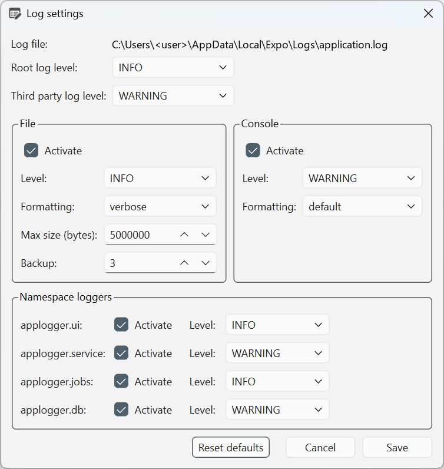

# Log settings

Select **Tools → Log settings…** in the [workbench window](index.md) to configure
diagnostic logging. These settings control application log messages, not the
contents of your datasets or analysis reports.

*The Log settings dialog, with an illustrative username substituted in the path.
The log-file path and selected values depend on your installation and
configuration. The Console group is hidden in packaged executables.*

## Save or reset log settings {#save-log-settings}

Change the controls you need, then select **Save**. The application writes the
logging configuration and reloads logging for the current session without
requiring a restart. Select **Cancel** to close without saving your edits.

**Reset defaults** fills the dialog with the default logging configuration.
Select **Save** to persist it, or **Cancel** to keep your saved configuration.
Resetting logging does not reset the separate [application settings](settings.md)
or delete existing log files.

## Locate the log file {#log-file}

**Log file** shows the application's current log-file path. You can select and
copy the displayed text to locate the file. The path is informational; this
dialog does not provide a file-location picker.

The file is written only while the **File** destination is active and messages
pass the applicable logging thresholds. Review logs before sharing them:
diagnostic messages can contain local paths, connection names or other details
about your work.

## Choose log levels {#log-levels}

A level is a minimum severity threshold. Each choice includes messages at that
level and all higher levels.

| Level | Messages included |
|---|---|
| **DEBUG** | Detailed diagnostics, plus all levels below in this table. |
| **INFO** | Routine operation messages, warnings and errors. |
| **WARNING** | Warnings, errors and critical failures. |
| **ERROR** | Errors and critical failures. |
| **CRITICAL** | Critical failures only. |

**Root log level** supplies the threshold for loggers that inherit it.
Application namespaces can have their own explicit levels, so changing only
the root level does not necessarily change their output.

**Third party log level** adds a minimum threshold for messages from libraries
outside the application's `applogger` namespace. File and console thresholds
still apply; this setting does not force additional messages to be emitted.

## Configure file and console output {#destinations}

The **File** and **Console** groups configure separate output destinations.
Uncheck **Activate** to remove a destination from the saved configuration.
Its remaining controls become disabled.

| Control | Purpose |
|---|---|
| **Level** | The minimum severity accepted by that destination. A message must first pass its originating logger's threshold. |
| **Formatting** | Choose `default` for severity, timestamp and message, or `verbose` to also include the source filename, line number and function. |
| **Max size (bytes)** | In the File group, the size threshold used for log rotation when backups are enabled. This is measured in bytes, not megabytes. |
| **Backup** | In the File group, the number of rotated backup files retained in addition to the current log file. Older backups are replaced as rotation continues. |

With **Backup** set to **0**, the rotating handler does not retain backups or
rotate the file. **Max size (bytes)** is therefore not a hard size cap in that
configuration.

**Console** output is available when running from source, such as from a terminal
or an IDE. Packaged executables hide this group and do not install the console
destination.

## Select application namespaces {#namespace-loggers}

Use **Namespace loggers** to configure levels for specific areas:

| Namespace | Area |
|---|---|
| `applogger.ui` | User-interface actions and controllers. |
| `applogger.service` | Data processing and other services. |
| `applogger.jobs` | Background-job execution and lifecycle. |
| `applogger.db` | Database operations. |

Checking **Activate** saves an explicit level for that namespace. Unchecking it
omits that namespace's override; it is **not a mute switch**. Its messages can
still be logged through inherited settings. A previously applied explicit level
can also remain in effect during the current session after its override is
removed.

Destination levels apply in addition to namespace levels. For example, setting
`applogger.db` to **DEBUG** while **File → Level** remains **INFO** does not write
database DEBUG messages to the file.

## Capture more detail for troubleshooting {#troubleshooting}

To collect detailed database diagnostics in the file:

1. Select **Tools → Log settings…**.
2. Under **File**, check **Activate**, select **DEBUG** for **Level**, and
   choose `verbose` for **Formatting**.
3. Under **Namespace loggers**, check **Activate** for `applogger.db` and set
   its **Level** to **DEBUG**.
4. Select **Save**, then reproduce the operation you are investigating.
5. Locate the file using the displayed **Log file** path.

This captures messages that the application actually emits; it does not
guarantee that every database operation produces DEBUG output. Leave
**Third party log level** unchanged unless you also need library diagnostics.
After collecting the information, restore your previous levels and save again
to avoid unnecessary log growth.
